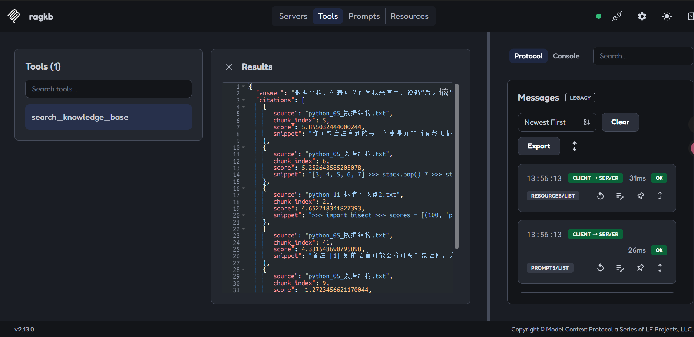

# Grounded RAG：可溯源的企业知识库问答系统

**答案必须落在检索到的证据上** —— 每条结论都标注来源片段；检索不到证据时明确拒答，而不是硬编。

> **技术栈**：Python 3.13 · LangChain · Milvus · BGE-M3 · BGE-Reranker · FastAPI · Docker
>
> **实测**（30 题分层金标 / 345 chunk）：HitRate@5 **0.952** · Recall@5 **0.857** · 拒答阈值 τ=0.2 零误杀 · **34 个测试 2 秒跑完** · 镜像 **2.75 GB**

## 快速开始（TL;DR）

### 方式一：Docker 一条命令（自带 Milvus）

```powershell
cp .env.example .env                                  # 填入 OPENAI_API_KEY / OPENAI_BASE_URL
docker compose -f docker-compose.full.yml up -d       # app + etcd + minio + milvus
curl http://127.0.0.1:8000/health                     # {"status":"ok","chunks":345}
```

首次启动约 4~5 分钟（加载模型 + 自动入库 345 条），之后重启约 1 分钟。接口文档：<http://127.0.0.1:8000/docs>

### 方式二：只用容器跑 Milvus，Python 在本机跑

```powershell
cp .env.example .env
docker compose -f docker-compose.full.yml up -d etcd minio milvus-standalone
pip install -r requirements.txt
python -m ragkb.main --ingest    # 首次入库（约 1~3 分钟）
python -m ragkb.main             # CLI 问答
python -m pytest ragkb/tests -q  # 34 passed
```

## 效果速览

| 指标 | 值 | 说明 |
|---|---|---|
| HitRate@5 | **0.952** | 至少命中 1 个证据片段的题占比（21 道可答题中 20 道） |
| Recall@5（macro，标准） | **0.857** | 每题先算命中比例、再对题目平均 |
| Recall@5（micro，辅助） | 0.778 | 片段池口径：21/27 个 gold 片段 |
| 检索层拒答 | τ=0.2：误杀 0、拦下 8/9 不可答 | 省 8 次 LLM 调用，拒答精确率 1.0 |
| 忠实度（10 题抽样） | 引用有效 10/10、强事实覆盖 1.000 | 不依赖 RAGAS 的轻量自检 |
| 工程 | 34 个测试 / 2 秒、镜像 2.75 GB | 测试全程不连 Milvus、不调 LLM |

> 完整的因子实验（单/多查询 × 有/无重排，各跑 3 次）与 k 曲线见 [eval_log.md](eval_log.md)。

## 1. 解决什么问题
  把非结构化文档变成可溯源的问答系统，每个答案都标出来源片段

## 2. 架构
[架构说明](architecture.md)

## 3. 模块职责
| 包 | 职责 | 依赖接口 |
|---|---|---|
| `parsers/` | 读文件 → List[Document] | `BaseParser` |
| `splitters/` | 切块 + 写 chunk_index | `BaseSplitter` |
| `embeddings/` | 文本 → 1024 维向量 | `BaseEmbedding` |
| `vectorstores/` | Milvus 连接/建表/插入/检索 | `BaseVectorStore` |
| `retrievers/` | BM25 索引、RRF 融合、重排、查询改写 | `BaseReranker` |
| `generators/` | Prompt → 回答 | `BaseGenerator` |
| `pipeline/` | 编排 `ingest` / `retrieve` / `query` | 以上全部（构造注入） |
| `service.py` | 结构化结果整形（citations / confidence / refused_by），HTTP 与 MCP 共用 | `pipeline` |
| `mcp_server.py` | MCP server：把检索暴露为 Agent 可调用的工具 | `service.py` |

## 4. 关键技术决策
- 抽象接口 + 依赖注入 → Pipeline 可脱离 Milvus/LLM 单测（34 个测试，2 秒跑完）
- 混合检索 + RRF → 稠密管语义、BM25 管精确编号（函数名 timeit、参数名 __all__、版本号 3.15）
- Cross-Encoder 重排 → HitRate@1 从 0.429 提到 0.524（+2 题），且压缩方差
- Multi-Query → 净收益 0，默认关闭（附实验表）
- 检索层拒答 → 用 rerank 分数的 sigmoid 做阈值（τ=0.2）：零误杀、拦下 8/9 不可答题，省 8 次 LLM 调用
- 忠实度自检 → 引用有效性 10/10、强事实覆盖率 1.0（10 题抽样），不依赖 RAGAS
- 上下文条数权衡 → k=5→8 使 Recall(macro) 从 0.857 升到 0.952，代价是 prompt 长约 60%；
  默认 k=5 保证基线可复现，多跳场景建议 `--top-k 8`（详见 eval_log 实验 8）

## 5. 评估体系与结果
- 30 题金标集（6 heading / 9 paraphrase / 6 multihop / 4 far / 5 near）
- gold 片段来自原文子串，用 validate_eval_set.py 自动校验（36/36 通过）
- 因子实验表（①②③④）

| # | 检索 | 重排 | HitRate@5 | HitRate@1 | MRR |
|---|---|---|---|---|---|
| ① | 单 | 关 | 0.905 | 0.429 | 0.629 |
| ② | 单 | 开 | 0.952 | 0.524 | 0.672 |
| ③ | 多 | 关 | 0.952 / 0.810 | 0.571 / 0.476 | 0.728 / 0.619 |
| ④ | 多 | 开 | 0.905 / 0.952 | 0.524 / 0.524 | 0.650 / 0.672 |

> ③④ 各跑 2 次（LLM 改写有随机性），①② 无 LLM 参与、结果确定，只跑 1 次。
>
> **指标口径**：`HitRate@k` = 至少命中 1 个 gold 片段的**题**占比（本表用这个）；
> `Recall@k` 是严格定义 = 命中的 gold **片段**数 / 总片段数。
> 30 题上三者分别是 **0.952 / 0.857 / 0.778**（HitRate / Recall-macro / Recall-micro）—— 差距集中在多跳题（每题需 2 个片段，只中 1 个时 HitRate 满分、Recall 只有 0.5）。

### 拒答阈值与忠实度

| 指标 | 结果 | 说明 |
|---|---|---|
| 拒答阈值 τ=0.2 | 误杀 0、拦下 8/9 不可答、漏放 1 | 拒答精确率 1.000，省 8 次 LLM 调用 |
| 引用有效率 | 10/10 = 1.000 | 答案里每个 `[n]` 都指向真实存在的片段 |
| 强事实覆盖率 | 1.000 | 答案中的数字与英文标识符全部能在 context 中找到 |

细节见 [eval_log.md](eval_log.md) 实验 5、实验 4。

## 6. 运行方式

> 所有命令都在**仓库根目录**执行，即包含 `ragkb/` 这一层的目录。
> 因为代码里用的是 `from ragkb.xxx import ...` 绝对导入，`python -m ragkb.main` 必须在仓库根目录运行。

### 6.0 前置要求

- Python 3.13
- Docker（用于启动 Milvus）
- 一个 OpenAI 兼容的 LLM API

需要配置的环境变量（参考 `.env.example`）：

| 变量 | 是否必填 | 说明 |
|---|---|---|
| `OPENAI_API_KEY` | **必填** | LLM 的 API Key |
| `OPENAI_BASE_URL` | **必填** | OpenAI 兼容接口地址，如 `https://api.deepseek.com/v1` |
| `MILVUS_URI` | 可选 | 默认 `http://localhost:19530` |
| `LLM_MODEL` | 可选 | 默认 `qwen3.8-flash` |
| `TOP_K` | 可选 | 默认 `5` |

在 PyCharm 里：`Run → Edit Configurations → Environment variables` 填入；
或在 PowerShell 里 `$env:OPENAI_API_KEY="sk-..."`（只对当前终端生效）。

### 6.1 安装依赖

```powershell
python -m venv .venv
.venv\Scripts\activate            # macOS / Linux: source .venv/bin/activate
pip install -r requirements.txt
```

首次运行会自动从 HuggingFace 下载两个模型（只需一次）：

| 模型 | 用途 | 大小 |
|---|---|---|
| `BAAI/bge-m3` | 文本向量化（1024 维） | ~2.2 GB |
| `BAAI/bge-reranker-base` | Cross-Encoder 重排 | ~1.1 GB |

国内网络建议先设镜像：

```powershell
$env:HF_ENDPOINT = "https://hf-mirror.com"
```

### 6.2 启动 Milvus

```powershell
docker run -d --name milvus-standalone `
  -p 19530:19530 -p 9091:9091 `
  milvusdb/milvus:v2.4.15 milvus run standalone
```

连接地址见 `config/settings.py` 的 `MILVUS_URI`（默认 `http://localhost:19530`）。

### 6.3 建库（首次 / 换语料时执行一次）

```powershell
python -m ragkb.main --ingest
# 入库完成，共 345 条（10 个语料文件）
```

语料放在 `ragkb/corpus/` 下。换语料 = 换这个目录里的 txt 文件，然后重跑本命令。

### 6.4 启动问答

```powershell
python -m ragkb.main
# BM25 索引已重建（345 条），跳过向量入库
# RAG 助手已启动，输入 q 退出。
```

日常启动**不会**重新算 embedding（否则每次要等 1~3 分钟），只重建内存里的 BM25 索引。

### 6.5 跑评估

```powershell
# 30 题题库 + 单查询 + 带重排（基线）
python -m ragkb.eval --skip-ingest --eval-set eval_set_v2.json

# 对照组：关掉重排
python -m ragkb.eval --skip-ingest --eval-set eval_set_v2.json --no-rerank

# 多查询
python -m ragkb.eval --skip-ingest --eval-set eval_set_v2.json --multi-query

# 换语料后必须加 --rebuild，否则测到的是两批语料的并集
python -m ragkb.eval --rebuild --eval-set eval_set_v2.json
```

校验题库里的 gold 片段是否都能命中：

```powershell
python -m ragkb.validate_eval_set --eval-set eval_set_v2.json
```

### 6.6 跑测试

```powershell
python -m pytest ragkb/tests -q
# 16 passed in ~2s —— 不连 Milvus、不调 LLM（全部用 tests/fakes.py 的假对象）
```

### 6.7 常见问题

| 现象 | 原因 | 解决 |
|---|---|---|
| `pymilvus` 连接超时 | Milvus 栈（etcd/minio/milvus）没启动 | `docker ps -a` 看状态，按 etcd → minio → milvus 顺序 `docker start` |
| `WinError 10054` / `Cannot send a request`（启动时） | 模型加载时联网校验 HF，但网络不通 | 模型已缓存，设 `HF_HUB_OFFLINE=1`、`TRANSFORMERS_OFFLINE=1` 即可离线启动 |
| `ModuleNotFoundError: ragkb` | 没在当前环境安装项目 | 仓库根执行 `pip install -e .` |

### 6.8 Docker 部署

前置：Docker Desktop 已启动；宿主机上已有 Milvus（项目 `rag`，服务名 `milvus-standalone`）。

```powershell
# 1) 构建镜像（首次 10~20 分钟，torch 约 2GB）
docker build -t ragkb-api:0.1.0 .

# 2) 启动（app 会加入 Milvus 所在的 rag_default 网络，用服务名直连）
docker compose up -d

# 3) 验证
docker compose ps
docker compose logs --tail 20 app
curl.exe http://127.0.0.1:8000/health
```

关键设计：

| 点 | 说明 |
|---|---|
| **网络** | app 与 Milvus 共享 `rag_default` 网络，`MILVUS_URI=http://milvus-standalone:19530`。容器间用**服务名**直连，不走宿主机、不受防火墙/VPN 影响 |
| **模型缓存** | 挂载 `HF_CACHE` 到 `/root/.cache/huggingface`（约 5.4GB），避免容器内重新下载 |
| **启动顺序** | 不用 `depends_on: service_healthy`，app 自带启动重试（8 次 × 5 秒） |
| **健康检查** | 探针打 `localhost:8000/health`，`start_period: 120s` 给模型加载留时间 |
| **CPU 版 torch** | Linux 下 pip 默认拉 CUDA 版（含 2.5GB nvidia-* 依赖）。显式装 CPU 版后镜像从 10.2GB 降到 **2.75GB** |
| **探针不能用 curl** | `python:3.13-slim` 没有 curl，探针必须用 `python -c` 做 HTTP 检查，否则永远 unhealthy |

实测：首次构建约 **18 分钟**（torch 下载占大头），镜像 **2.75GB**；全栈启动约 **4 分钟**（etcd/minio 30s → milvus 42s → app 加载模型 + 自动入库 345 条）。

常见问题：

| 现象 | 原因 | 解决 |
|---|---|---|
| `Fail connecting to milvus-standalone:19530` | Milvus 没启动，或 app 不在 `rag_default` 网络 | `docker ps` 确认 Milvus Up；`docker compose up -d` 让 app 重建并加入网络 |
| 启动卡在下载模型 | `HF_CACHE` 没配 | 在 `.env` 写 `HF_CACHE=<你的用户目录>/.cache/huggingface`（如 `C:/Users/你的用户名/.cache/huggingface`，用正斜杠）（正斜杠） |
| `bind: address already in use` | 8000 被旧容器占 | `docker ps` 找到并 `docker stop` |
| `docker compose down -v` | ⚠️ 会删数据卷 | 只想停止服务请用 `docker compose down` |

### 6.9 MCP 接口（供 Agent 调用）

把知识库封装成 MCP（Model Context Protocol）工具：任何支持 MCP 的客户端（Claude Desktop / Cursor / 自研 Agent）都能零适配接入，不必为每个客户端写一遍适配代码。

```powershell
python -m ragkb.mcp_server        # stdio 传输，前台常驻（等待客户端连接）
```

| 项 | 说明 |
|---|---|
| 传输 | **stdio**（stdout 是协议通道，本进程内不得 `print`，日志一律走 stderr） |
| 工具 | `search_knowledge_base(question: str, top_k: int = 5)` |
| 返回 | `answer` / `citations` / `confidence` / `refused` / `refused_by` |



> 上图：官方 MCP Inspector 连上本例 server，调用 `search_knowledge_base` 后返回的答案与 5 条引用（含 chunk_index / rerank 分数 / 片段锚点）。

**字段约定**（给调用方决策用）：

| 字段 | 含义 |
|---|---|
| `citations[].snippet` | 该 chunk 的**前 80 字**，作用是**定位锚点**；完整证据请看原 chunk |
| `confidence` | `sigmoid(最高 rerank 分)`；未开重排时为 `null`（不与 rrf 分数混用，量纲不同） |
| `refused_by` | `retrieval` = 检索层拦下（未调 LLM、零成本）；`generation` = 模型自判资料不足 |

**两个易踩的坑**：

1. 宿主机运行 MCP server 时必须有 `MILVUS_DB_NAME=ragkb`（与 compose 中 app 一致）。若用默认的 `rag_implement`，会连到一个**空库**——**空库不报错，只表现为全部拒答**（`confidence: null` + `citations: []` 就是典型信号）。
2. 全栈 compose 默认不对外发布 19530；宿主机上的进程要直连 Milvus 时，需给 `milvus-standalone` 加 `ports: "19530:19530"`（本仓库已加）。

**边界**：本项目只提供 **server**（能力的出口）。Agent 侧的自主决策（何时调用、调用几次、失败如何重试、如何记忆）不在本项目范围内，属于下一个项目。

## 7. 已知局限
- 语料仅 345 chunk（企业通常 10 万级）
- 21 道可答题，单题 = 4.76pp，指标差异需谨慎
- pointwise 重排对多跳题负收益（6/6 → 5/6）
- 无权限过滤、无增量更新、单轮问答
- 未做服务化（无 HTTP 接口、无 Docker 镜像）
- Recall@5（macro）= 0.857、micro = 0.778，均低于 HitRate@5 的 0.952：多跳题常只找到一半证据
- 强事实覆盖率只覆盖"数字 + 英文标识符"，中文事实（如术语、人名）无法自动验证
- 拒答阈值 τ 在 30 题上选出，边界题（0.215 / 0.308）离阈值很近，换题库需复验

## 8. 语料来源与许可

本项目代码采用 **MIT License**（见 `LICENSE`）。

`ragkb/corpus/` 下的 10 个文本文件抓取自 **Python 官方中文教程**（<https://docs.python.org/zh-cn/3/tutorial/>），
用于构造可复现的检索评测语料，非本项目原创内容。

- 原文版权：© Python Software Foundation，采用 **PSF License**（允许复制与再分发，须保留版权声明）
- 抓取得到的文本中保留了原页面的版权页脚，`fetch_corpus.py` 可重新抓取
- 本项目自身代码建议以 MIT License 发布（`LICENSE` 文件待补）

评测题库 `eval_set_v2.json` 中的 `gold_snippets` 全部为上述语料的**原文子串**，
可用 `validate_eval_set.py` 逐条校验（当前 36/36 通过）。